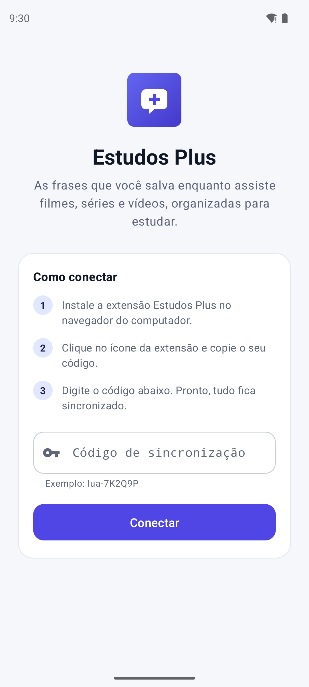
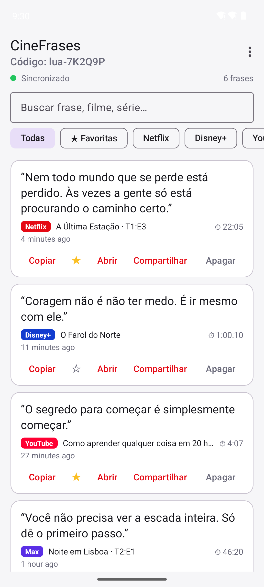
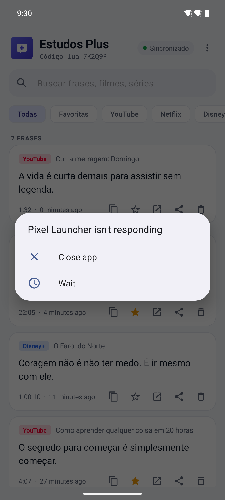
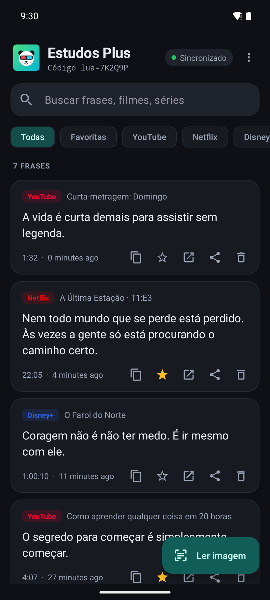
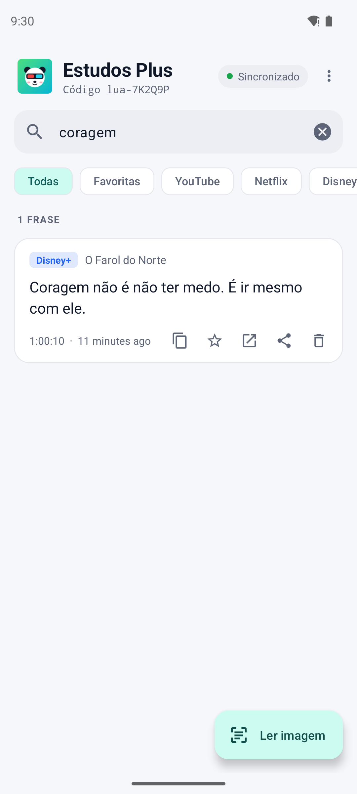
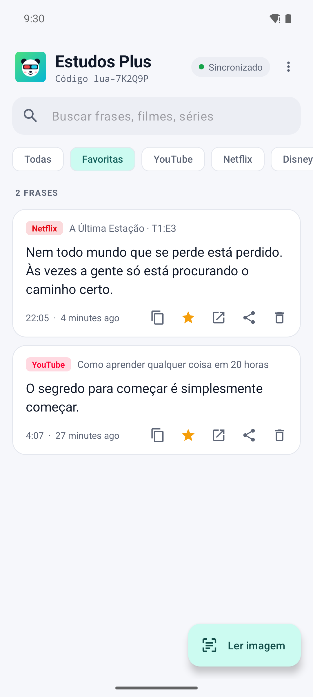

# CineFrases 🎬❝

Copie **instantaneamente** a frase (legenda) que está na tela enquanto assiste a um filme, série ou vídeo — e receba ela **na hora** no app Android.

```
 ┌───────────────────────┐      POST /phrases       ┌──────────────┐   tempo real (SSE)   ┌─────────────────┐
 │ Extensão do navegador │ ───────────────────────▶ │   Servidor   │ ───────────────────▶ │ App Android     │
 │ Netflix, Disney+, Max │ ◀─────────────────────── │ (Cloudflare) │ ◀─────────────────── │ (Java)          │
 │ Prime, YouTube...     │   lista ao vivo (SSE)    └──────────────┘  favoritar / apagar  └─────────────────┘
 └───────────────────────┘
```

Extensão e app usam o **mesmo código de sincronização** (ex.: `lua-7K2Q9P`). Tudo o que é copiado na extensão aparece no app em menos de um segundo; favoritar ou apagar no app também reflete na extensão.

## Prints do app

| Conectar | Frases sincronizadas | Frase chegando ao vivo | Tema escuro |
|---|---|---|---|
|  |  |  |  |

| Busca | Favoritas |
|---|---|
|  |  |

> Gerados automaticamente num emulador Android pelo workflow *Prints do app* (`.github/workflows/screenshots.yml`).

## Estrutura

| Pasta        | O que é |
|--------------|---------|
| `extension/` | Extensão para Chrome/Edge/Brave/Opera (Manifest V3) |
| `cloudflare/`| Servidor de sincronização na **Cloudflare** (Workers + Durable Objects) — recomendado |
| `server/`    | Mesmo servidor em Node.js, para rodar no seu PC (alternativa) |
| `android/`   | App Android nativo em **Java** |

---

## 1. Servidor (Cloudflare)

O servidor já está publicado em **`https://cinefrases.thyagohikins.workers.dev`**, e esse endereço vem **fixo** na extensão (`extension/config.js`) e no app (`android/app/build.gradle`, campo `SERVER_URL`). O usuário não precisa configurar nada além do código.

Para publicar de novo depois de mudar o código do servidor, veja o [TUTORIAL-CLOUDFLARE.md](TUTORIAL-CLOUDFLARE.md):

```bash
cd cloudflare
npm install
npm run deploy
```

Cada código de sincronização vira um *Durable Object* que guarda as frases (SQLite) e mantém as conexões em tempo real.
Testes locais (sobe o Worker com `wrangler dev`): `npm test`.

> `server/` tem o mesmo servidor em Node.js, usado nos testes e nos prints automáticos.

## 2. Extensão

1. Abra `chrome://extensions` (ou `edge://extensions`).
2. Ative o **Modo do desenvolvedor**.
3. Clique em **Carregar sem compactação** e selecione a pasta `extension/`.
4. Clique no ícone do CineFrases: o seu **código** (ex.: `lua-7K2Q9P`) já aparece, criado automaticamente. É só digitar esse código no app.
   O menu também mostra se a legenda da aba atual está sendo detectada.

### Como usar

- Ative as **legendas** no player.
- **`Alt + C`** → copia a frase que está na tela e envia para o app.
- **`Alt + X`** → mostra as últimas falas (deu tempo de a legenda sumir? clique na fala anterior).
- Ou passe o mouse sobre o vídeo e use o botão **❝ Copiar frase**.
- Também existe o atalho global `Alt + Shift + C` (configurável em `chrome://extensions/shortcuts`).
- Funciona em tela cheia.
- Sem internet/servidor? A frase é copiada mesmo assim e fica numa fila; é enviada automaticamente quando a conexão voltar (o número pendente aparece no ícone).

Serviços: **Netflix, YouTube, Disney+, Max (HBO), Prime Video, Globoplay, Paramount+, Crunchyroll, Apple TV+** e, em geral, **qualquer site com vídeo legendado**. A detecção combina seletores conhecidos de cada serviço, legendas nativas do HTML5, players dentro de *shadow DOM* e uma busca genérica por elementos de legenda sobre o vídeo.
Se nenhuma legenda for encontrada, o Alt+C copia o texto que você tiver selecionado.
Cada frase vai com o nome do filme/série, o serviço, o minuto do vídeo e o link (no YouTube, o link já abre no segundo exato da fala).

> Os sites de streaming mudam o HTML com frequência. Se algum parar de funcionar, os seletores ficam no topo de `extension/content.js` (lista `SITES`). Depois de instalar ou atualizar a extensão, as abas já abertas passam a funcionar sem precisar recarregar.

## 3. App Android (Java)

**Baixar pronto:** cada push gera o APK no GitHub Actions → aba *Actions* → último *Build* → artefato **CineFrases-apk**. Instale o `app-debug.apk` no celular (permita "instalar apps desconhecidos").

**Compilar:** abra a pasta `android/` no Android Studio e clique em ▶ Run, ou:

```bash
cd android
./gradlew assembleDebug
```

O APK fica em `android/app/build/outputs/apk/debug/app-debug.apk`. (minSdk 26 / Android 8.0+.)
Para apontar o app para outro servidor: `./gradlew assembleDebug -PserverUrl=https://outro-endereco`.

### Conectando o app

Na primeira tela, digite o **código** que aparece no ícone da extensão e toque em **Conectar**. Pronto.

### O que o app faz

- Recebe as frases **em tempo real** (com reconexão automática) e destaca a que acabou de chegar.
- Busca por texto, título ou serviço; filtros por **favoritas** e por serviço.
- Copiar, favoritar ★, abrir o vídeo no ponto da fala, compartilhar e apagar (com **Desfazer**).
- Exportar/compartilhar a lista inteira.
- Guarda uma cópia local: abre e mostra as frases mesmo sem conexão.

## API do servidor

| Método | Rota | Descrição |
|--------|------|-----------|
| GET    | `/api/health` | Status |
| GET    | `/api/rooms/:codigo/phrases` | Lista (mais recentes primeiro) |
| POST   | `/api/rooms/:codigo/phrases` | Adiciona `{ text, source, sourceName, title, videoTime, url, id?, createdAt? }` — reenvio com o mesmo `id` é ignorado |
| POST/PATCH | `/api/rooms/:codigo/phrases/:id` | Atualiza `{ favorite?, note?, text? }` |
| DELETE | `/api/rooms/:codigo/phrases/:id` | Apaga |
| GET    | `/api/rooms/:codigo/stream` | Server-Sent Events: `add`, `update`, `delete` |

O código de sincronização funciona como senha da sua lista: use um código difícil de adivinhar (o botão *Gerar* já faz isso).
